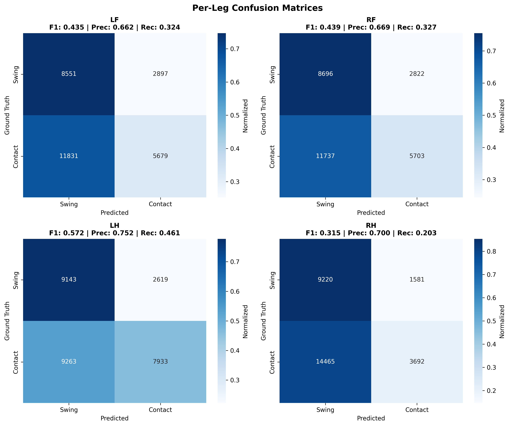
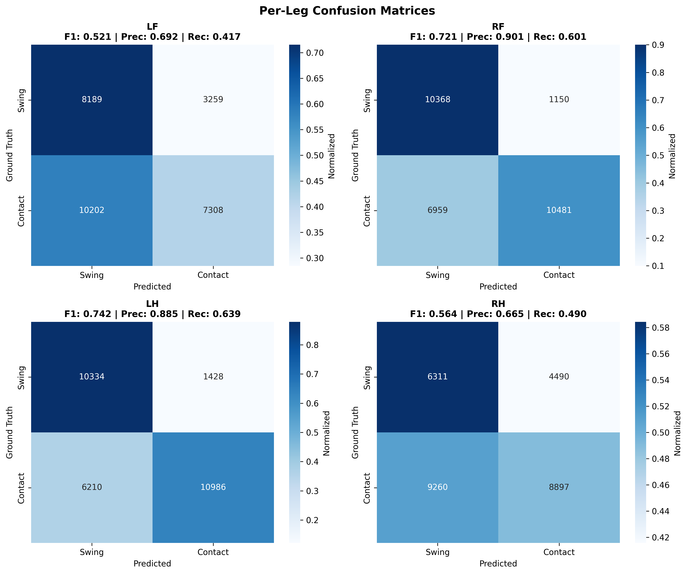
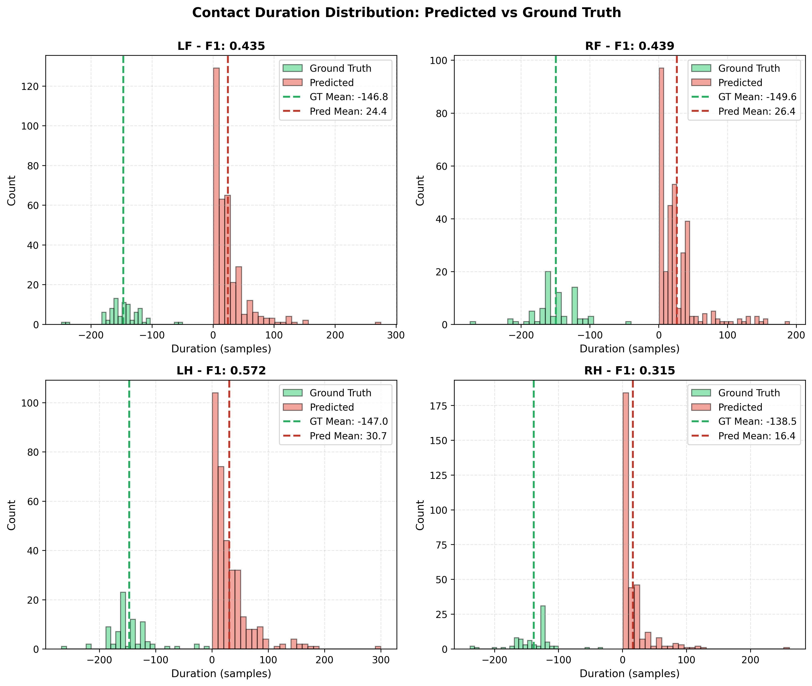
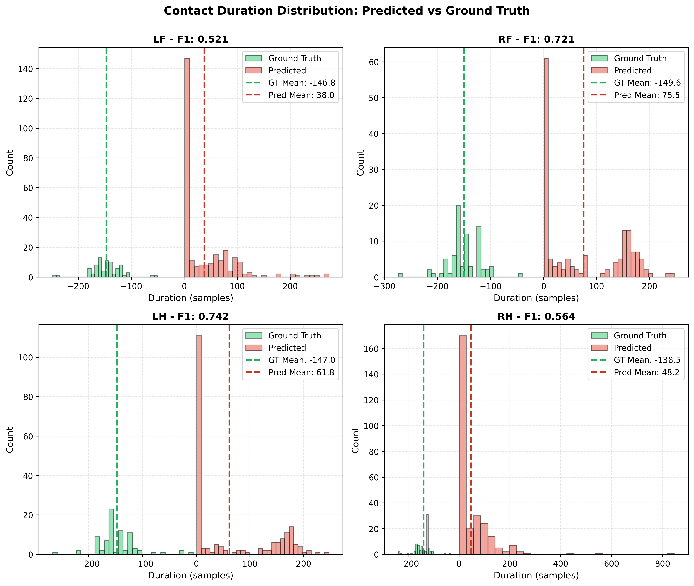
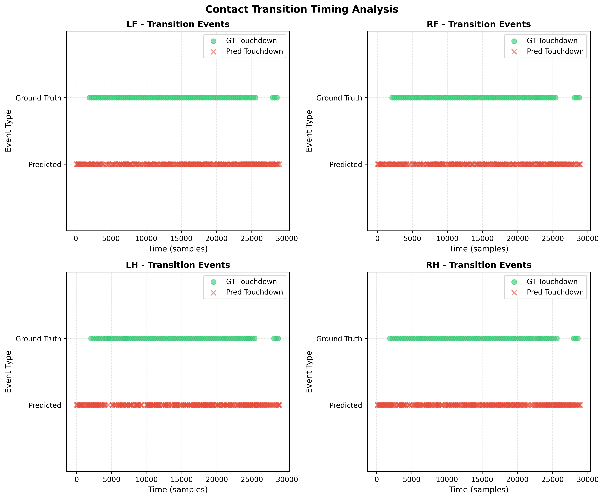
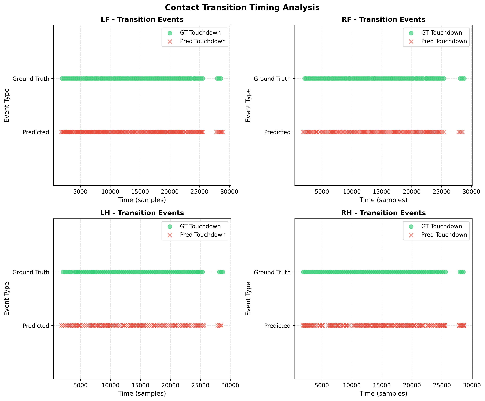

# ContactNet

### Progressive CNN-GRU for Proprioceptive Contact Estimation in Quadrupedal Robots

ContactNet is a deep learning framework for estimating foot-contact states in quadrupedal robots using proprioceptive measurements.

Developed as part of graduate research at the **University of São Paulo (USP), Brazil**, ContactNet extends CNN-based contact estimation to the **Unitree Go1** and **Unitree Go2** quadrupeds through multi-scale recurrent temporal modelling, robot-specific data acquisition and processing, and independent model training and evaluation.

The framework introduces a **Progressive CNN-GRU** architecture that combines convolutional feature extraction with early and late GRU branches. It predicts one of **16 possible contact configurations** ($2^4$ binary contact combinations across the four legs) using **48-dimensional leg-local proprioceptive measurements**, without requiring base IMU measurements as network inputs.

---

## Key Features

- **Progressive CNN-GRU Architecture:** Integrates early and late recurrent branches at intermediate convolutional depths to capture both short-duration impact transients and sustained stance dynamics.
- **IMU-Independent 48D Input Representation:** Uses joint positions, joint velocities, body-frame foot positions, and body-frame foot velocities ($150$-sample window at $1\text{ kHz}$), eliminating terrain-coupled IMU bias drift.
- **ROS Bag Acquisition & Signal Conditioning:** Extracts `/estimated_robot_state`, transforms end-effector kinematics into the robot body frame, and conditions ground-truth labels via Otsu thresholding, hysteresis stabilization, and minimum-duration filtering.
- **Dual-Level Evaluation:** Assesses performance across both 16-class contact configurations and individual legs (`RF`, `LF`, `RH`, `LH`).

---

## Quickstart

```bash
git clone https://github.com/Masateemah123/ContactNet.git
cd ContactNet
pip install -r requirements.txt

# Train (uses built-in synthetic quadruped trot sequences if ./data/go1/ is absent)
PYTHONPATH=. python3 src/train_lightning.py --config configs/train.yaml

# Evaluate on test set
PYTHONPATH=. python3 src/test.py --config_name configs/test.yaml

# Single-sequence inference
PYTHONPATH=. python3 src/inference_one_seq.py --config configs/inference.yaml
```

---

## Model Architecture

| Component | Configuration |
| :--- | :--- |
| Input shape | $150 \times 48$ ($0.15\text{ s}$ at $1\text{ kHz}$) |
| Convolutional blocks | 3 ($48 \rightarrow 64 \rightarrow 128 \rightarrow 256$) |
| Early GRU branch | Hidden size $64$ (after CNN Block 2) |
| Late GRU branch | Hidden size $64$ (after CNN Block 3) |
| Fused representation | $128$ features |
| Classification head | $128 \rightarrow 512 \rightarrow 256 \rightarrow 16$ classes |

```text
Input Sequence (B, 150, 48)
           |
           v
   CNN Block 1 (48 -> 64)
           |
           v
   CNN Block 2 (64 -> 128)
           |
           +----------------------+
           |                      |
           v                      v
  Early GRU (128 -> 64)   CNN Block 3 (128 -> 256)
           |                      |
           |                      v
           |              Late GRU (256 -> 64)
           |                      |
           +----------+-----------+
                      |
                      v
        Concatenation (128 Features)
                      |
                      v
         Classifier (128 -> 512 -> 256)
                      |
                      v
                  16 Classes
```

### 48D Input Representation

| Feature Group | Dimensions | Description |
| :--- | :---: | :--- |
| Joint positions ($q$) | 12 | Actuated joint angles |
| Joint velocities ($\dot{q}$) | 12 | Actuated joint angular velocities |
| Foot positions ($p_f$) | 12 | Body-frame end-effector positions |
| Foot velocities ($v_f$) | 12 | Body-frame end-effector velocities |
| **Total** | **48** | **Leg-local proprioceptive features (IMU excluded)** |

---

## Experimental Results & Sim-to-Real Analysis

### 1. Simulated Architectural Comparison (Gazebo-ROS Noetic)

Evaluated on identical chronological splits across 12 terrains and 5 gaits ($T_w = 150$):

| Model Architecture | Parameters | FLOPs | Validation F1 | Key Trade-off |
| :--- | :---: | :---: | :---: | :--- |
| **CNN (Baseline)** | 10.90M | 0.146G | 0.970 | High parameter count; lacks explicit sequence memory |
| **GRU-only** | 2.06M | 0.420G | 0.980 | Strong temporal coherence; no spatial feature hierarchy |
| **CNN-GRU (Deep / Serial)** | 691K | 0.620G | 0.940 | Early spatial compression masks short-duration impacts |
| **CNN-GRU (Hierarchical)** | 691K | 0.850G | 0.960 | Parametric coupling and sequential overhead |
| **ContactNet (Progressive)** | **691K** | **1.12G** | **0.980** | Multi-scale GRU fusion captures impact transients and stance dynamics |

| Simulation Test Metric | RF (Leg 0) | LF (Leg 1) | RH (Leg 2) | LH (Leg 3) | Mean |
| :--- | :---: | :---: | :---: | :---: | :---: |
| **Accuracy (%)** | 98.8% | 98.3% | 98.8% | 98.6% | **98.63%** |
| **Precision (%)** | 98.5% | 97.9% | 98.9% | 98.3% | **98.40%** |
| **Jaccard Index** | 0.975 | 0.968 | 0.977 | 0.973 | **0.973** |
| **FPR / FNR (%)** | 1.01 / 1.50 | 1.18 / 2.15 | 1.17 / 1.15 | 1.11 / 1.71 | **1.12 / 1.63** |

---

### 2. Domain-Gap Analysis: Why Removing the Base IMU (`54D -> 48D`) Improves Transfer

Ornstein-Uhlenbeck (OU) stochastic noise modeling and Power Spectral Density (PSD) analysis revealed severe terrain-coupled non-stationarity in base IMU signals between concrete and grass:

| OU Noise Parameter | Axis | Concrete (Rigid) | Grass (Compliant) | Domain Shift Impact |
| :--- | :---: | :---: | :---: | :--- |
| **White Noise ($\sigma_{\text{white}}$)** | Accel X ($\text{m/s}^2$) | 1.750 | 0.573 | $>3.0\times$ variance shift across terrains |
| **White Noise ($\sigma_{\text{white}}$)** | Accel Z ($\text{m/s}^2$) | 5.260 | 1.720 | High-frequency impact ringing on rigid ground |
| **White Noise ($\sigma_{\text{white}}$)** | Gyro Z ($\text{rad/s}$) | 0.760 | 0.096 | $\sim 7.9\times$ angular-rate vibration divergence |
| **Bias ($\tau$ Component)** | Gyro Z ($\text{rad/s}$) | 0.130 | -0.004 | Non-stationary low-frequency gyroscope drift |

Dropping the 6 base-IMU channels (`54D -> 48D`) eliminated inertial bias drift and stabilized zero-shot hardware deployment.

---

### 3. Zero-Shot Real-World Hardware Evaluation (48D IMU-Free)

Two checkpoints with comparable Gazebo validation F1—**Model A (`Epoch 19`)** and **Model B (`Epoch 27`)**—were evaluated offline **without fine-tuning** on physical **Unitree Go1** and **Unitree Go2** hardware logs:

#### Unitree Go1 Outdoor Multi-Terrain Trials

| Terrain / Trial | Checkpoint | 16-Class Accuracy | Mean Per-Leg Accuracy | Mean L1 Error (Legs) | Notes |
| :--- | :---: | :---: | :---: | :---: | :--- |
| **Concrete** (w/ Trot) | **Model A (`ckpt-19`)** | **76.29%** | **88.89%** | **0.445** | Leg-F1: **0.935**; Per-leg: `[90.5%, 89.3%, 88.6%, 87.2%]` |
| **Concrete** (Standard) | **Model A (`ckpt-19`)** | **75.65%** | **88.21%** | **0.472** | Sharp rigid impacts preserve temporal alignment |
| **Concrete** | Model B (`ckpt-27`) | 23.37% | 56.18% | 1.753 | Leg-F1: 0.509 |
| **Grass** (Compliant) | **Model B (`ckpt-27`)** | **48.65%** | **71.29%** | **1.149** | Better captures damped, low-stiffness stance phases |
| **Grass** (w/ Trot) | Model A (`ckpt-19`) | 11.19% | 50.74% | 1.970 | Macro F1 (base run): 0.642; underestimates long stance |
| **Inclined Ramp** | **Model A (`ckpt-19`)** | **34.42%** | **73.64%** | **1.054** | Outperforms `ckpt-27` (`56.94%` mean leg acc.) |
| **Force Plate** (w/ Trot) | **Model A (`ckpt-19`)** | **29.88%** | **52.34%** | 1.906 | Per-leg: `[49.8%, 51.9%, 56.7%, 51.0%]` |
| **Asphalt** | **Model A (`ckpt-19`)** | **22.08%** | **57.76%** | **1.690** | Leg-F1: **0.618** vs. `0.559` (`ckpt-27`) |

#### Cross-Platform Generalization on Unitree Go2 (`Model A — ckpt-19`)

| Go2 Locomotion Sequence | 16-Class Accuracy | Mean Per-Leg Accuracy | RF (Leg 0) | LF (Leg 1) | RH (Leg 2) | LH (Leg 3) |
| :--- | :---: | :---: | :---: | :---: | :---: | :---: |
| **Stiff Run** (Rigid) | **73.43%** | **91.75%** | 93.64% | 91.37% | 87.13% | 94.85% |
| **Soft Run** (Compliant) | **43.99%** | **81.75%** | 65.27% | 84.49% | 83.61% | 93.62% |
| **Combined Stiff + Soft** | **62.71%** | **86.66%** | 84.77% | 89.67% | 78.28% | 93.93% |
| **Soft Walk Stair** | **79.53%** | **93.32%** | 94.30% | 91.79% | 91.69% | 95.49% |

#### Quantitative Domain-Gap Metrics (Concrete vs. Grass)

| Metric | Concrete (Rigid) | Grass (Compliant) | Gap ($\Delta$) | Physical Interpretation |
| :--- | :---: | :---: | :---: | :--- |
| **Domain Generalization Error (DGE) $\downarrow$** | **0.214** | 0.387 | `+0.173` | Larger latent feature shift on viscoelastic turf |
| **Feature Transfer Robustness (FTR) $\uparrow$** | **94.1%** | 81.6% | `-12.5%` | Higher feature alignment retention on rigid ground |
| **End-Point Error (EPE) $\downarrow$** | **0.031** | 0.067 | `+0.036` | Lower instantaneous contact-state deviation |
| **Cross-Domain Contact Stability (CDCS) $\uparrow$** | **0.923** | 0.784 | `-0.139` | Higher temporal stance/swing consistency |

---

## Experimental Visual Diagnostics (Real-World Hardware)

### 1. Per-Leg & 16-Class Confusion Matrices (Concrete vs. Grass)

| **Concrete — Rigid (`Model 19`)** | **Grass — Compliant (`Model 27`)** |
| :---: | :---: |
|  |  |

*Per-leg binary confusion matrices (top) and 16-state configuration matrices (bottom). Rigid concrete preserves clean stance/swing separation across legs, whereas compliant grass introduces false-negative stance dropouts and diagonal trot dominance.*

### 2. Stance-Phase Duration Distributions (Concrete vs. Grass)

| **Concrete (`Model 19`)** | **Grass (`Model 27`)** |
| :---: | :---: |
|  |  |

*Distribution of continuous stance durations (in $1\text{ kHz}$ samples) comparing ground truth (green) against ContactNet predictions (red), illustrating short-duration stance fragmentation under attenuated ground-reaction impulses.*

### 3. Touchdown Event Alignment & Chatter Diagnostics

| **Concrete — Clean Transition Tracking** | **Grass — Chatter During Idle/Swing Gap** |
| :---: | :---: |
|  |  |

*Touchdown event detection across a 30-second (30,000-sample) hardware rollout. Rigid concrete cleanly tracks the non-contact gap between samples `26,000–28,000` (left), whereas compliant grass exhibits false-positive touchdown chatter across idle intervals (right).*

---

## Future Work

1. **Viscoelastic Contact Modeling & Domain Randomization:** Train with variable ground stiffness, damping, and friction anisotropy in simulation to prevent early CNN filters from overfitting to rigid-body impact spikes.
2. **Latent Domain Alignment:** Incorporate Maximum Mean Discrepancy (MMD) or adversarial feature alignment between simulated and real proprioceptive windows.
3. **Temporal Post-Processing & Hysteresis Filtering:** Apply minimum-duration / hysteresis smoothing on predicted logits to eliminate short-duration stance fragmentation ($< 50\text{ ms}$) during quasi-static phases.
4. **InEKF State Estimation Integration:** Fuse ContactNet's 48D IMU-free contact probabilities into an Invariant Extended Kalman Filter for drift-reduced legged odometry.

---

## Publications & Acknowledgments

### Publications
- **ContactNet: Proprioceptive Quadrupedal Foot Contact State Estimation and Sim-to-Real Domain Gap Analysis** — Masa Thema et al., *2026 IEEE Conference Publication*.
- **Comprehensive Review of Contact Estimation Methods for Legged Robots** — Thema Masa, Vivian Suzano Medeiros, Marcelo Becker, *2025 Brazilian Conference on Robotics (CROS)* ([IEEE Xplore](https://ieeexplore.ieee.org/document/11066135/)).
- **Master's Research — University of São Paulo (USP)** ([USP Digital Repository](https://repositorio.usp.br/item/003319254)).

### Framework & Collaboration Attribution
- **Foundational Research:** Builds upon [Deep Contact Estimator](https://github.com/UMich-CURLY/deep-contact-estimator) (Lin et al., *CoRL 2021*, UMich-CURLY).
- **Lab Collaboration:** Preliminary multi-terrain experiments were conducted collaboratively with **Juliano Decico Negri** at **EESC-LabRoM** ([`EESC-LABRoM/contact-estimator-lars-2025`](https://github.com/EESC-LABRoM/contact-estimator-lars-2025)). This standalone repository contains my independent ContactNet architecture, PyTorch Lightning pipeline, and MIT-licensed data interface developed at **EESC/USP**.
- **Funding:** Financed in part by **CAPES** (Finance Code 001), **ANP / Petrobras / EMBRAPII / FAFQ** (`2023/00013-7`, `2023/00016-6`), and **FAPESP** (`2025/03705-2`).

---

## Author

**Masa Thema** — Mechanical Engineering, University of São Paulo (USP), São Carlos, Brazil
