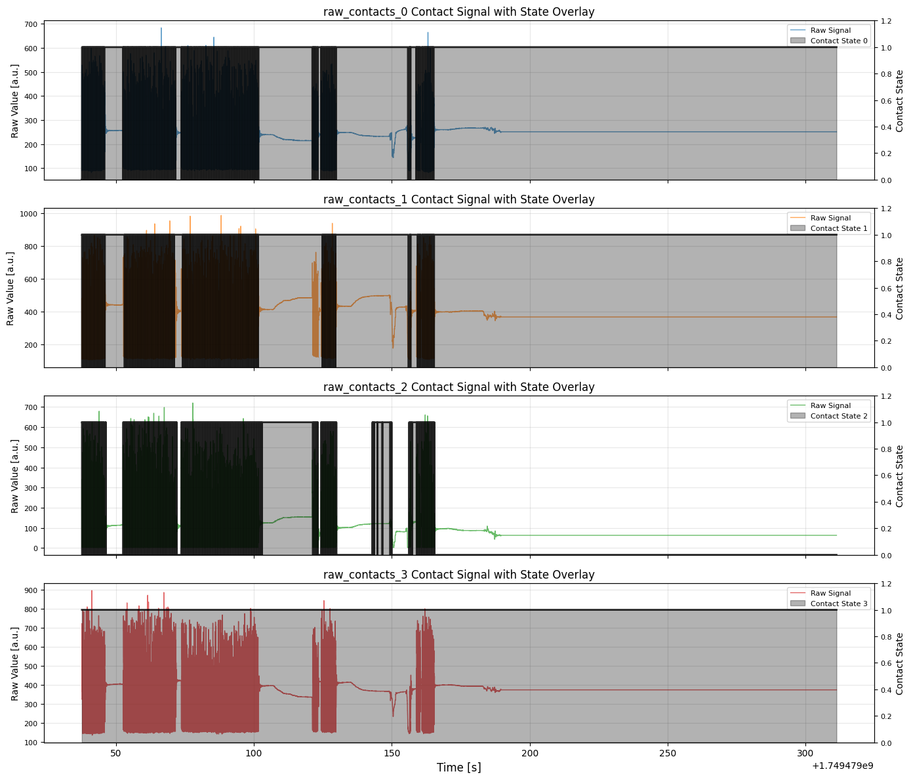
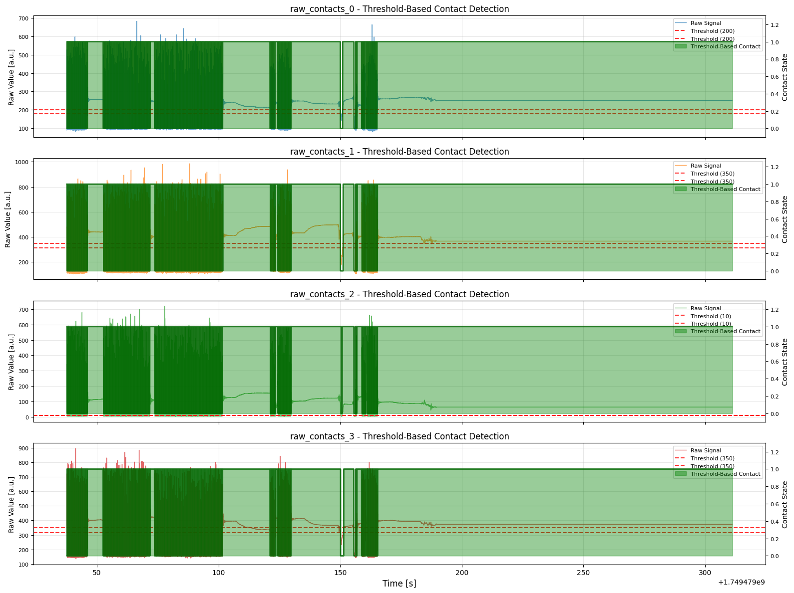
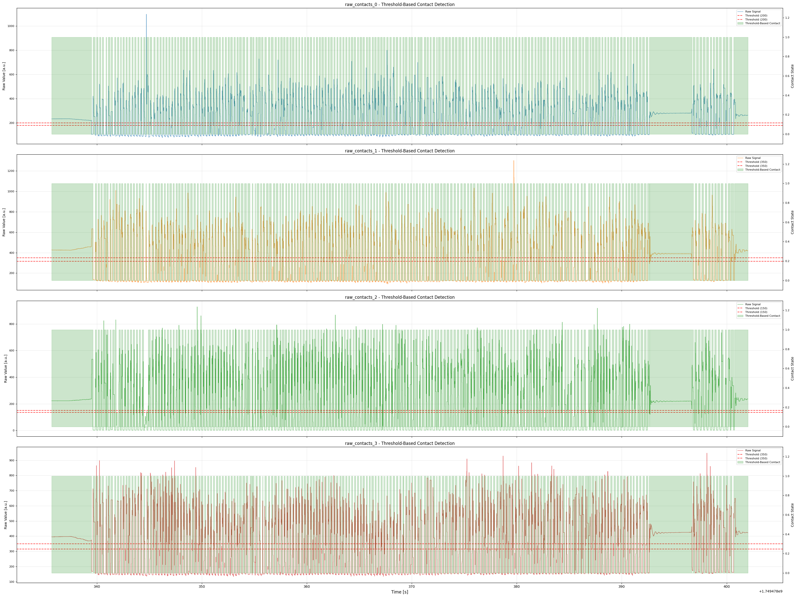
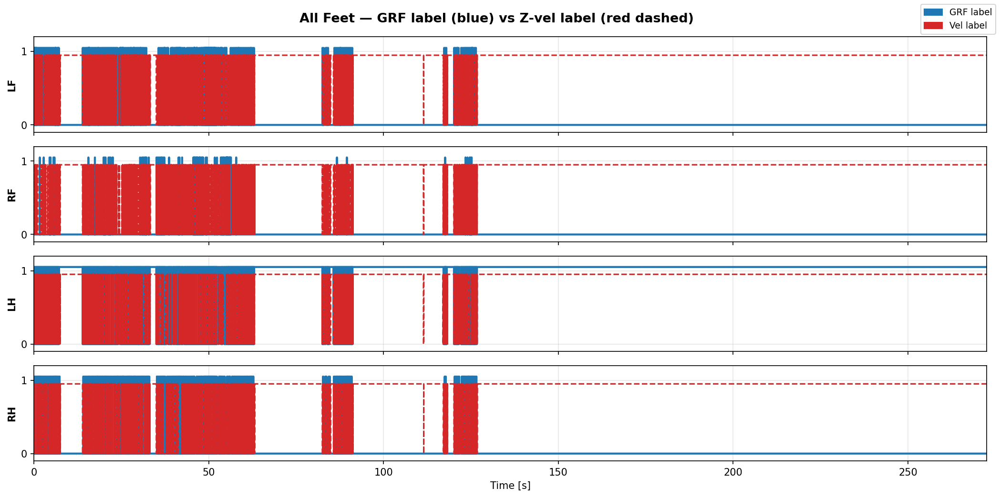

# ContactNet Data Processing, Stuck-Leg Contact Conditioning & IMU Ablation

This branch documents the ROS1 (Unitree Go1 / Gazebo) and ROS2 (Unitree Go2) preprocessing notebooks, `thresholding.py` contact conditioning script, and spectral/statistical domain-gap diagnostics.

---

## 1. Ground-Truth Contact Conditioning (`thresholding.py`)

In the recorded Unitree ROS1 bags (`/unitree/raw_contact`), raw pneumatic foot-contact sensors exhibited baseline offset drift that caused individual legs to remain falsely latched in contact during static and swing phases, alongside high-frequency impact chatter.

`thresholding.py` resolves this via a three-stage conditioning pipeline:
1. **Otsu-Guided Threshold Analysis:** Computes bimodal inter-class variance thresholds (`otsu_threshold`) and statistical priors (`mean + 0.5*std`, `mean + std`) per leg.
2. **Dual-Threshold Hysteresis ($\alpha = 0.9$):** Separates contact onset ($F_{\text{th}}$) from release ($0.9\,F_{\text{th}}$) to eliminate vibration-induced switching.
3. **Minimum-Duration Filtering ($50\text{ ms}$):** Suppresses sub-$50\text{ ms}$ transient spikes and micro-dropouts.

```bash
python3 thresholding.py --bag_file data/raw_bags/trial.bag --output_csv improved_contact_labels.csv
```

### Before vs. After Contact Conditioning (Concrete & Asphalt Trials)

| **Raw Sensor Signal (Unconditioned Concrete)** | **Conditioned Contact Labels (Concrete)** |
| :---: | :---: |
|  |  |

### High-Vibration Terrain Conditioning (Asphalt Hysteresis & Multi-Leg Summary)

| **Asphalt Dual-Threshold Hysteresis** | **Multi-Leg Conditioning Verification Summary** |
| :---: | :---: |
|  |  |

---

## 2. Why Base IMU Channels Were Removed (`54D -> 48D`)

- **PCA Manifold Alignment:** Joint kinematics (`q, qd`) overlap between Gazebo simulation and real hardware, whereas `IMU + Omega` trajectories diverge into disjoint drift manifolds.
- **Frequency-Domain PSD & OU Noise Mirroring:** Real terrain IMU power spectral density exceeds Gazebo simulation by $10^2\times$–$10^4\times$ across `0–250 Hz` while simulation exhibits $100\text{ Hz}$ physics-step notches. Even with Ornstein-Uhlenbeck ($\Sigma$ white noise + $\tau$ bias) noise injection, excluding the 6 base IMU channels yielded superior zero-shot transfer across terrains and platforms (`Go1 -> Go2`).

---

## 3. Included Files

- `thresholding.py`: Standalone Otsu + dual-threshold hysteresis + minimum-duration contact label conditioning script.
- `Preprocessingsim.ipynb`: Gazebo ROS1 bag extraction, coordinate transformations, and `54D` vs. `48D` feature construction.
- `RealdataPreprocessingGo1.ipynb`: Unitree Go1 ROS1 hardware bag parsing, leg reordering (`RF, LF, RH, LH`), and contact label conditioning.
- `RealDataProcessingRos2.ipynb`: Unitree Go2 ROS2 bag extraction for zero-shot cross-platform inference.
- `load_config.py` / `load_data.py`: Configuration and NumPy array loading utilities.
